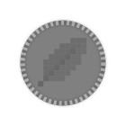

<!-- PROJECT LOGO -->
<br />
<div align="center">
  

<h3 align="center">mint</h3>

<p align="center">
  <strong>A fast, small and readable arena and pool allocator single header C++ library</strong>
</p>

<p align="center">
  <a href="#usage">Usage</a> •
  <a href="#building">Building</a> •
  <a href="#project-structure">Project Structure</a> •
  <a href="#license">License</a>
</p>

</div>

---

## About

What this project is, and what it is not.

## Usage

```cpp
#include <mint/mint.hpp>

auto text = mint::greeting();
```

## Building

Requires CMake 3.15+ and a C++17 compiler. On Windows, open the folder in Visual Studio 2022 and pick a configuration from the dropdown, or from a terminal (after loading the matching `vcvars64.bat`/`vcvars32.bat`):

```
cmake --preset x64-Debug
cmake --build --preset x64-Debug
ctest --preset x64-Debug
```

Presets: `x64`/`x86` combined with `Debug`, `Release`, `RelWithDebInfo`, `MinSizeRel`, `ReleaseNoOptWithDeb` (no optimization, debug info, `NDEBUG` on) and `DebugASan` (AddressSanitizer). Output goes to `build/<preset>/`.

## Project Structure

```
include/mint/   public headers
src/                  implementation
examples/             small programs that use the library
tests/                test runner (registered with ctest)
docs/                 documentation and the logo
CMakePresets.json     build configurations
```

## License

This repository uses two licenses: the source code is open source, and the artwork is not.

* **Source Code:** All software and source code files are licensed under the **[MIT License](./LICENSE)**. You are free to use, modify, and distribute the code commercially or non-commercially.
* **Icons & Assets:** Everything in the **[`/docs`](./docs/)** directory is excluded from the MIT License. All rights reserved: do not copy, redistribute, modify, or use these files (including for AI training) without written permission. See the **[Icon License](./docs/LICENSE-ART.md)**. Forks are welcome, but the icons stay under their own terms.


---

<div align="center">
  <p>Made with ❤️</p>
</div>
